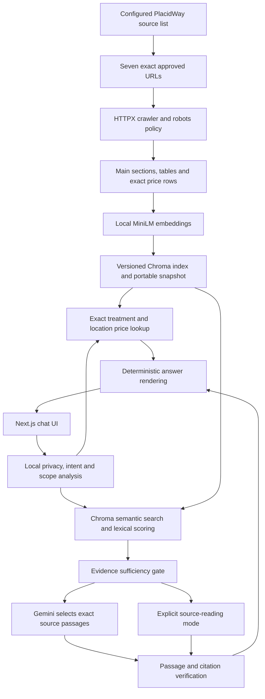

# Architecture and trust boundaries

This is a single-assistant application with a Next.js static frontend and a FastAPI backend. A combined deployment serves both from one origin. It requires no database service, authentication provider, or paid embedding API.

## Source boundary

`config/approved_sources.yaml` defines the seven HTTPS URLs that form the chatbot's knowledge base. `load_sources` rejects duplicate IDs, duplicate URLs, unexpected hosts, query strings, and fragments. The broader research in `docs/placidway-data.md` is never ingested.

The crawler fetches robots.txt separately as permission metadata. At ingestion the site requested a ten-second crawl delay, which overrides the one-second minimum. It uses an identifying User-Agent, bounded response sizes, timeouts, limited retries, and Retry-After. Redirects cannot change source identity. Access failures do not trigger alternative scraping or recursive crawling.

Extraction selects the main article area and drops navigation, forms, scripts, popups, and related-experience promotions. Table rows stay intact with their column headers. The package's displayed starting-price qualifier is retained separately from its inpatient/outpatient table rows. A `$` without an explicit currency code remains `$`; the system does not silently infer USD.

## Embeddings and index

The model is `sentence-transformers/all-MiniLM-L6-v2`. Both Sentence Transformers and ONNX execution are implemented. The serving default is the same model's ONNX export, which avoids importing PyTorch on a small host. Local comparison of two representative embeddings produced cosine agreement of 1.0. This is a small compatibility check, not a universal numerical-equivalence guarantee.

Evidence chunks preserve headings and use approximately 420-word windows with 55 words of overlap. MiniLM itself has a 256-wordpiece limit. To avoid embedding only the beginning of a long evidence passage, the embedder averages normalized 180-word windows at a stride of 150, then normalizes again. A word window may still be truncated by the tokenizer for unusually fragmented terms. Short sections and complete table rows remain intact.

The manifest records model ID, pinned model revision, execution backend, embedding pipeline version, source allowlist fingerprint, source timestamps, content checksums, and artifact checksums. Model/backend/pipeline mismatches require rebuilding. Unchanged chunks reuse embeddings only when the manifest is compatible.

Each rebuild writes a new directory, validates artifacts, builds Chroma, checks collection counts, and executes a query. Only then does an atomic pointer switch activate it. A failed rebuild leaves the previous pointer untouched. A filesystem lock prevents concurrent rebuilds. The public application uses one worker; this is intentional for in-memory limits and context.

The portable snapshot contains chunks, structured prices, float32 vectors, and a manifest. The application can reconstruct Chroma from it after an ephemeral host restart without recrawling the website or recomputing embeddings. The model assets are packaged during the Docker build.

## Query and answer boundary

Raw visitor messages are analyzed locally. Only intent, treatment, clinic, destination, program, and aspect values from fixed vocabularies enter the Gemini request. Visitor names, contact details, medical narratives, and entire chat histories are not forwarded. Pattern-based privacy detection is imperfect, so not sending raw messages is the stronger privacy safeguard.

Greetings, help requests, thanks, and ambiguous package questions receive local conversational replies. The API supplies fixed, localized suggested questions that were checked against the current seven-page index; the interface shows them as clickable follow-ups. An unrelated question receives a scope explanation and suggestions without an irrelevant quote prompt. Factual treatment and price answers still require source evidence and citations.

Conversation memory stores those bounded topic fields for at most 30 minutes, with a 1,000-session cap. It never treats a previous assistant answer as evidence. Context is process-local and is lost on restart. The frontend saves up to 20 conversations and 60 messages per conversation in the browser's localStorage. Visitors can reopen or delete each conversation from the sidebar. This history is not synced between browsers or accounts. Deleting a browser conversation removes its displayed messages and saved browser copy; the server's limited topic context expires separately after at most 30 minutes. Visitors are asked not to enter personal medical details.

Retrieval combines normalized cosine similarity with lexical overlap and intent-heading relevance. A named cancer package restricts retrieval to its exact approved page. Pricing uses structured records for the exact treatment, location, clinic, and program. Conflicting rows for an identical price identity cause abstention. A package price cannot establish an unlisted component cost. For a comparison, the app requires exactly one same-procedure clinic listing from each of two named countries on the approved comparison page and matching displayed currency symbols. It reports the numerically lower listing with both original rows and a warning that sessions and inclusions are not proven equivalent; other comparisons abstain.

The evidence gate requires intent-specific text. For example, program duration cannot establish recovery duration; inclusions require an actual inclusions heading; unknown destinations cannot silently become Mexico. The supported topic vocabulary is deliberately narrow. Some legitimate phrasings will receive an unknown response rather than a speculative interpretation.

Gemini uses the official `google-genai` SDK and a configurable model name. It receives no web-search, grounding, file-search, or browsing tools. The evidence payload includes approved source titles and treatment labels so a package inclusion excerpt can be matched to its treatment even when the excerpt itself omits the name. The structured result contains only selected chunk IDs and exact passages. The renderer rejects invented IDs, unapproved URLs, rewritten numbers, dropped line-level qualifiers, and text not found in the retrieved evidence. A complete sentence selected from inside a source line is expanded to that original line before display; fragments from the middle of a sentence still fail validation. URLs come from the allowlist, never from generated text.

Verbatim fidelity does not prove that a passage is relevant or medically correct. The local gate and question constraints reduce relevance errors, and the UI attributes medical claims to the website. This system does not independently establish clinical efficacy.

The optional `ANSWER_MODE=extractive` selects passages locally using the same retrieval and validation pipeline. This mode is labeled in the UI. It is not an automatic fallback for a failed Gemini call. In `gemini` mode, credential, quota, timeout, and malformed-output failures produce an unavailable response.

## Serving and security

The API provides chat, health, knowledge status, authorized refresh, refresh status, and unanswered-topic reporting. Admin access requires a bearer secret of at least 32 characters and constant-time comparison. No admin secret is bundled in the frontend.

The application validates message length, limits request bodies, uses a bounded per-client rate limiter, and caps model generations per rolling day. It does not trust client-supplied forwarding headers. A reverse proxy may therefore make visitors share a limit. Production rate limiting should be moved to a trusted edge before scaling.

Unanswered logs contain constrained topics and reasons, not raw questions or visitor identifiers. SDK error messages are not logged because they can contain request details. Logging and quotas are local and reset with ephemeral storage or restarts; they are not durable billing controls. The operator must keep paid billing disabled independently.
